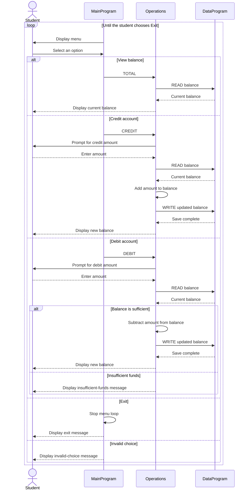

# Student Account Management Program

This directory contains documentation for the COBOL account-management example in `src/cobol`. The program provides a simple console workflow for viewing a balance, crediting an account, and debiting an account.

## COBOL Files

### `main.cob` - `MainProgram`

Implements the console menu and controls the program loop. It accepts a menu choice and calls `Operations` to view the balance, credit the account, or debit the account. Choosing 4 exits; any other unsupported choice displays an error and returns to the menu.

### `operations.cob` - `Operations`

Implements account operations:

- `TOTAL`: reads and displays the current balance.
- `CREDIT`: prompts for an amount, reads the current balance, adds the amount, saves the new balance, and displays it.
- `DEBIT`: prompts for an amount, reads the current balance, and subtracts and saves the amount only when sufficient funds are available. Otherwise, it displays an insufficient-funds message.

This program delegates balance reads and writes to `DataProgram`.

### `data.cob` - `DataProgram`

Stores the account balance in working storage, initialized to `1000.00`. Its procedure accepts an operation and balance: `READ` copies the stored balance to the caller, while `WRITE` replaces the stored balance with the caller's value. This is in-memory storage; the balance is not persisted between program runs.

## Student Account Rules and Current Limitations

- The example maintains one shared balance; it does not identify individual students or support multiple accounts.
- The starting balance is `1000.00` for each program run.
- Credits are added to the balance without checking that the entered amount is positive or otherwise valid.
- A debit is allowed when the current balance is greater than or equal to the requested amount. A debit larger than the balance is rejected without changing the balance.
- Amounts and balances use `PIC 9(6)V99`, representing up to six integer digits and two decimal digits. The implied decimal point is not stored as a character.
- The code does not validate malformed input, negative amounts, account ownership, or transaction history. In particular, because credit and debit amounts are not checked for positivity, the current behavior should not be treated as production-ready student-account policy.

## Application Data Flow

